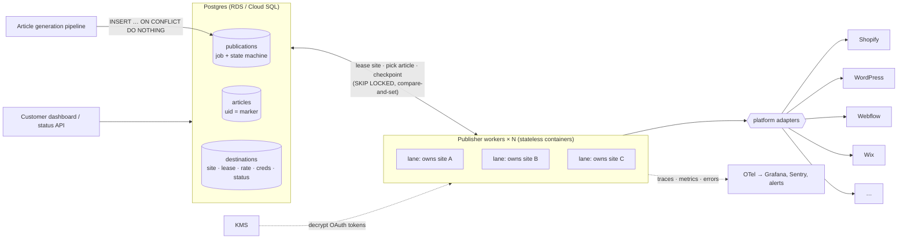
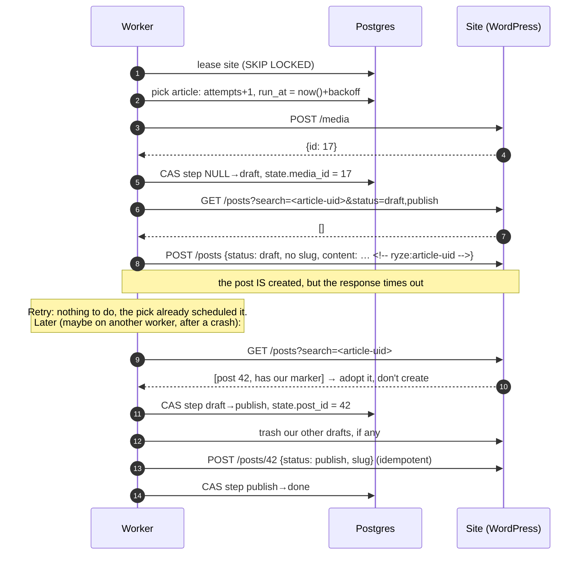
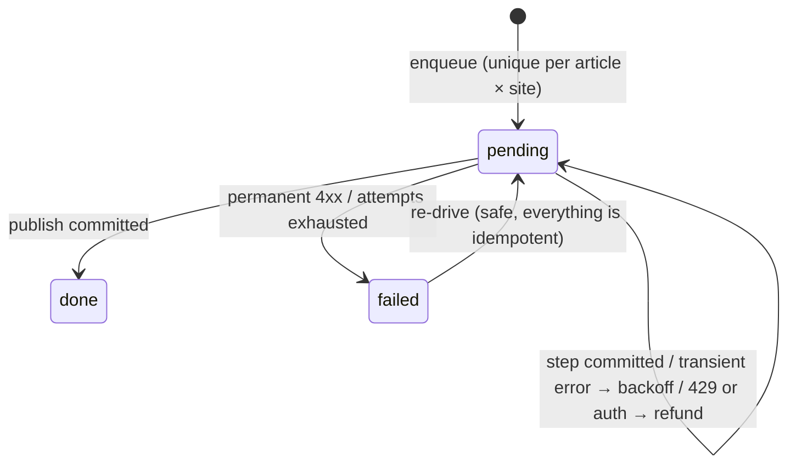

# Publishing 200,000 articles a day

Design review plus a small working version (diagrams: [design.html](design.html)). Run `python chaos.py` to watch it publish 500 articles to 20 flaky
sites while the workers get SIGKILLed and frozen, and to check that every article ends up live exactly once, at its own slug.

Slides: [English (PDF)](docs/presentation-en.pdf) · [Russian (PDF)](docs/presentation-ru.pdf)

## TL;DR

* **Postgres is the queue, the state machine and the lock manager.** Workers are stateless. There's no Kafka,
  Redis or Temporal: at 2–25 articles/s they would cost a lot to operate and none of them solves the hard part.
* **The lease unit is what the platform rate-limits, usually the customer's site.** One worker owns a site at
  a time, so it can pace that site's calls locally without a shared limiter, and round-robin leasing keeps one
  big customer from starving everybody else.
* **"Live exactly once" = idempotent enqueue + a commit after every step with compare-and-set + slugless
  drafts that the next attempt finds by the article's uid + an idempotent publish of the one committed id.**
  Leases only decide who works when. Correctness never depends on them.

## 1. Numbers

| | |
|---|---|
| Articles | 200k/day = **2.3/s** on average. Assume 10× peaks (everyone schedules for 09:00) ≈ **25/s** |
| Platform calls | ~5 per article (media, find, create draft, find leftovers, publish) ≈ 1M/day, ~125/s peak |
| Concurrency | ~0.5 s per call, ~2.5 s per article done one call after another ⇒ **~60 sites in flight at peak**: 3 processes × 20 lanes, which also gives HA |
| DB writes | ~6 per article ≈ 1.2M/day, ~150/s peak: easy for one Postgres |
| Storage | ~70M publication rows/year: one table is fine with the partial index on `pending`. Move `done` rows older than 90 days to an archive table. Don't partition by month: Postgres needs the partition key inside `UNIQUE (article_id, destination_id)` |

On "exactly once": none of these platforms takes an idempotency key on post creation, so exactly-once
*delivery* is impossible. Every call can time out after it has taken effect. What we can guarantee is an
exactly-once **effect**: calls run at least once, every step is idempotent or deduplicated, and readers see
the article once.

## 2. Architecture



The whole service is three tables ([schema.sql](schema.sql)) and one worker loop ([publisher.py](publisher.py)):

| table | role |
|---|---|
| `articles` | written by the generation pipeline, read-only for us. `uid` is the article's stable identity, and it is the marker we stamp on the remote post |
| `destinations` | one rate-limit scope, usually a customer site: platform, credentials, `rate_per_sec`, `status` (`active` / `needs_reauth` / `disabled`), `lease_until` |
| `publications` | one article → one site, `UNIQUE (article_id, destination_id)`. It is the job (`run_at`, `attempts`), the state machine (`step`, `state`) and the audit trail (`last_error`) all at once |

Since the job *is* the state row, there is no dual write and no queue to keep in sync with the database.

## 3. The worker loop

1. **Lease a site.** Pick the least recently served `active` site that has something due:
   `UPDATE destinations SET lease_until = now()+60s … FOR UPDATE SKIP LOCKED`. Workers never block each other.
2. **Pick its next due article.** `attempts += 1` and `run_at = now() + backoff(attempts)` happen *before*
   any work starts (a visibility timeout). If the worker dies halfway, the article comes back on its own. A
   crash loop on one article (a poison pill) burns attempts like any other failure.
3. **Run the remaining steps** from the adapter, e.g. `media → draft → publish`. After every step, commit
   its result with `UPDATE … SET step = next, state = … WHERE id = … AND step = current` (compare-and-set).
4. After a 20 s slice, or once nothing is due, **release the site** so the next one gets a turn. On a 429 (or a
   503 with `Retry-After`, in seconds or as an HTTP-date), release it until then: the whole site backs off.





## 4. Why every article is live exactly once

**Invariant:** the only action readers can see, *publish*, is applied only to the post id recorded in
Postgres, and Postgres accepts exactly one post id per publication.

| threat | defence |
|---|---|
| daily batch re-run, double enqueue | `UNIQUE (article_id, destination_id)` + `ON CONFLICT DO NOTHING` |
| create timed out but actually happened | the draft step searches for a post carrying the article's uid before it creates one, and adopts it |
| crash between the platform's 200 and our commit | same: the next attempt finds the post and adopts it |
| two workers on one article (frozen VM/GC pause outlives the lease) | CAS on `step`: one result wins, the loser gets `LostRace` and stops. Its draft is never published |
| publish response lost | publish is idempotent: `status=publish` twice is the same as once |
| search lags behind writes | the worst case is a second **draft**. Drafts carry no slug, so it can't push the live post to `slug-2`, and the publish step trashes the leftovers it can see |
| a customer's own post has the same slug | never adopted (no marker). Ours goes live as `slug-2` and the dashboard warns the customer |
| DB restored from an old backup | the marker is the article's uid, not the publication's, so even a row lost and enqueued again finds the post. Find prefers the live post over drafts |

The checks for the last three run on a fake that follows WordPress's slug rules. The reviewer reproduced the
`slug-2` and backup duplicates on a real WordPress 7.1.3 before the fix ([REVIEW.md](REVIEW.md), B1 and B2).

## 5. Failures and edge cases

| situation | behaviour |
|---|---|
| timeout / 5xx / network error | retry with exponential backoff + jitter (30 s → 1 h cap). After 10 attempts (~4 h), `failed` + alert |
| 429, or 503 with `Retry-After` | the **whole site** backs off for `Retry-After` (seconds or HTTP-date); the attempt is refunded |
| 401/403 | where tokens expire, refresh once (under a compare-and-set on the credentials row: a zombie can outlive its lease). Still failing: site → `needs_reauth` *if its credentials are still the ones that failed*, its articles wait without burning attempts, the customer is notified, and the site drains on reconnect |
| permanent 4xx (invalid HTML, blog deleted) | `failed` right away, with the platform's message for the customer |
| worker SIGKILLed | site lease expires (60 s), the article is already rescheduled, work resumes from the last committed step |
| deploy (SIGTERM) | finish the current article, release sites, exit. Nothing waits for leases to expire |
| worker frozen longer than its lease | becomes a zombie: CAS rejects its commits, and it releases a site only if the lease is still its own |
| DB failover | lanes reconnect: committed steps stand, the rest is retried |
| one customer schedules 5,000 articles on one site | one lane drains them at that site's rate (~3 h at 2 req/s), and everyone else keeps flowing (round robin) |
| platform-wide outage | per-article backoff is enough at this volume. Add a per-platform circuit breaker if the retry noise bothers us |
| clock skew | every time comparison uses Postgres `now()`, never a worker's clock |
| adapter's steps change while articles are in flight | step names are persisted, so treat them like a schema. During a rolling deploy old workers don't know new steps: ship the code that understands a step before the code that writes it |

## 6. Platforms

Each adapter has to keep the contract in [platforms.py](platforms.py): nothing visible before the last step,
the create step can find its own earlier attempt, and publish is idempotent. The demo implements WordPress.
The rest is checked against the platforms' docs, but still has to be verified against the API version you pin:

| platform | invisible create | find our post | idempotent publish | limits / auth gotchas |
|---|---|---|---|---|
| WordPress | `status=draft`, **no slug** (WP counts drafts when it dedupes slugs). Media named by the article uid: headers are ASCII, slugs may not be | `search=<article-uid>` + `<!-- ryze:uid -->` in `content.raw` (`context=edit`). The marker survives kses | trash leftover drafts (cleanup only: with `EMPTY_TRASH_DAYS=0` it's a 501), then `{status: publish, slug}` | no limits of its own: hosts and WAFs limit, often per IP and shared by many sites. Application passwords need HTTPS (`is_ssl()`, which can be false behind a TLS proxy) |
| Shopify | article `isPublished: false`, metafield `ryze.article_uid` set in the same `articleCreate` | `articles(query: "handle:…")`, check the metafield | `articleUpdate isPublished: true` | GraphQL cost bucket per store. **Throttling and `userErrors` both arrive as HTTP 200**: map `THROTTLED` to `RateLimited` and `userErrors` to `Fatal` |
| Webflow | CMS item `isDraft: true` | a hidden marker field in the collection (a schema change at onboarding). Don't rely on slug uniqueness | `POST /collections/{id}/items/publish` (it clears `isDraft` itself). The 202 can be partial (`errors[]`): check it | limits are **per API key** (60 or 120 req/min by plan), with `Retry-After`. If one key serves several sites, the key is the lease unit. A site publish is limited to 1/min |
| Wix | draft post | content is Ricos JSON, so no HTML comment: marker in `seoData` tags, query drafts by title and check the marker | publish the draft (idempotent) | OAuth access tokens last 4 h and come from client credentials, with no refresh token. Rate-limit scope isn't documented |

## 7. Stack, and what I chose not to use

**Use:** managed Postgres (RDS/Aurora/Cloud SQL). `SKIP LOCKED` queues are proven tech (Oban, River, graphile-worker,
solid_queue). Stateless workers on ECS/Kubernetes. Python asyncio + httpx here, though the language doesn't
matter. OAuth tokens envelope-encrypted with KMS. OpenTelemetry traces (one span per step), Prometheus/Grafana, Sentry.

**Not used, on purpose:**

* **Kafka / SQS / RabbitMQ.** Job state still has to live in the DB, so you get dual writes (or an outbox) and
  at-least-once delivery anyway. Every mechanism above would still be needed. Volume is ~2 msgs/s. The closest
  managed equivalent of the site lease, SQS FIFO with `MessageGroupId = site`, brings the dual write back.
* **Redis rate limiter.** Owning the site lets a lane pace it locally. Leasing per article instead means every
  worker sleeps on the same hot site's limiter.
* **Temporal.** Durable execution is nice, but the hard part (a non-idempotent create on someone else's API) is
  still ours, and it brings a cluster to run. Worth it if flows grow to days with human approvals, or if the
  team already runs it.

## 8. Operating it

* **SLO:** a due article is live within 15 min, *for sites under their own throughput*. A 5,000-article burst on
  one site drains at that site's rate by design.
* **Autoscale** on *due sites without a lane*, not on oldest due age: extra workers don't speed up one site.
* **Metrics:** published/min and failure rate per platform and error class, 429s per site, sites in
  `needs_reauth`, lost races, leftover drafts, slugs taken by the customer.
* **Re-drive:** `UPDATE publications SET status='pending', attempts=0, run_at=now() WHERE status='failed' AND …`.
  It's safe because every step is idempotent.
* **Kill switch:** `UPDATE destinations SET status='disabled' WHERE platform='wix'`.

## 9. When things change

| change | what to do |
|---|---|
| 10× volume | still one Postgres: PgBouncer (psycopg needs `prepare_threshold=None` in transaction mode), the archive table, a `next_due_at` column so the lease query skips idle sites |
| 100× volume | shard by `destination_id`, which is already the lease unit |
| one site needs more than one lane | N lease slots per site |
| a platform with an app-wide quota | add a per-platform token bucket (Redis GCRA) on top of the per-site pacing |
| a platform without drafts | find-before-create still covers timeouts and crashes. For a zombie with a stale search, a duplicate can be **visible** until a sweeper finds two posts with our marker and unpublishes one. The guarantee is weaker there |
| a platform with idempotency keys | pass the article uid, and the find step can go |
| editing or unpublishing published articles | a revision row per change. Update is a PUT, idempotent by nature |

## 10. Known trade-offs

Left as they are on purpose, and fine at this scale:

* **The lease isn't renewed mid-article.** One very slow article (5 calls × 15 s timeout) can outlive the 60 s
  lease, and a second lane then paces the same site too. CAS keeps that correct. The fix is to renew the lease
  after each step and set an overall deadline per call.
* **No per-site circuit breaker.** A customer site that is down for a day turns its articles `failed` after ~4 h.
  Re-drive is safe.
* **A lost publish response can end as `failed` while the post is live.** The fix is to GET the post before
  marking `failed` at the publish step.
* **Fairness is per site, not per customer.** A customer with 1,000 sites gets 1,000 turns.
* **A customer's copy of our post carries our marker.** "Duplicate Post" copies the marker too, and with admin
  credentials a replayed publish would trash that copy. The fix is to keep only posts whose `author` is our user,
  and never trash a published one.
* **Non-ASCII slugs raise a false "slug taken" warning.** WP returns them percent-encoded. The fix is to compare
  `unquote(slug)`.
* **Finding our post relies on WP's own search.** A search plugin (ElasticPress, Relevanssi) that lags or strips
  comments breaks adoption after a DB restore. CAS still keeps the normal path safe. A fallback is to also look
  up the live post by slug.
* **A replayed publish resets a slug the customer changed by hand**, because publish always sends the slug.
* **Site identity isn't normalized.** The same WordPress connected twice (`www.` and bare) is two destinations.
  Both publications find the same marker, so the article is still live once.

## 11. The demo

| file | |
|---|---|
| [schema.sql](schema.sql) | the three tables |
| [publisher.py](publisher.py) | the worker: lease, pick, steps, checkpoint, error handling (~155 lines) |
| [platforms.py](platforms.py) | adapter contract, HTTP→error mapping (`Retry-After` in seconds or date), per-site pacing, WordPress adapter |
| [fake_platform.py](fake_platform.py) | WordPress-shaped fake with chaos: 500 before/after the write, hangs past the timeout, 429, 401, lagging search, WP's slug rules, an optional disabled trash |
| [chaos.py](chaos.py) | end-to-end check: 20 sites, 500 articles (every 10th with a Cyrillic slug) enqueued twice, workers SIGKILLed and frozen, one site's credentials revoked and then fixed, plus a forced worst-case race and a replay after a DB restore on a site with the trash disabled |

```bash
docker compose up -d                       # Postgres on :5433
python3 -m venv .venv && .venv/bin/pip install -r requirements.txt
.venv/bin/python chaos.py
```

```
500 publications for 500 articles (enqueued twice), {'done': 500}
workers SIGKILLed: 25, frozen past their lease: 7, retries: 358, 429s: 163, lost races: 1, leftover drafts trashed: 0, still drafts: 1
live twice: 0, never live: 0, live at the wrong slug: 0 []
zombie check: ['lost race', 'published'], live at ['article-353']
restore check (trash disabled): published, replayed from step draft, re-enqueued: live at ['статья-290']
OK: every article is live exactly once, at its own slug
```

The check can actually fail. Each of these mutations was confirmed to break it:

* without the `AND step IS NOT DISTINCT FROM` guard, the zombie check publishes twice;
* drafts that carry the slug go live as `slug-2`;
* a marker built from the publication id instead of the article uid gives two live posts after a re-enqueue;
* a media filename built from the slug never publishes the Cyrillic articles;
* treating the 501 from a disabled trash as an error blocks publishing.

The run also asserts that the parked site burned no attempts and that every `Retry-After` was parsed.

Left out on purpose: only the WordPress adapter is built, credentials are stored as plain text, and there are no
metrics and no OAuth refresh. An independent review of the design and the code is in [REVIEW.md](REVIEW.md).
A second pass checked the fixes on a real WordPress 7.1.3 and found two more ways an article could fail to publish (N1, N2). Everything marked as required in both passes is fixed. The rest is in Known trade-offs.
